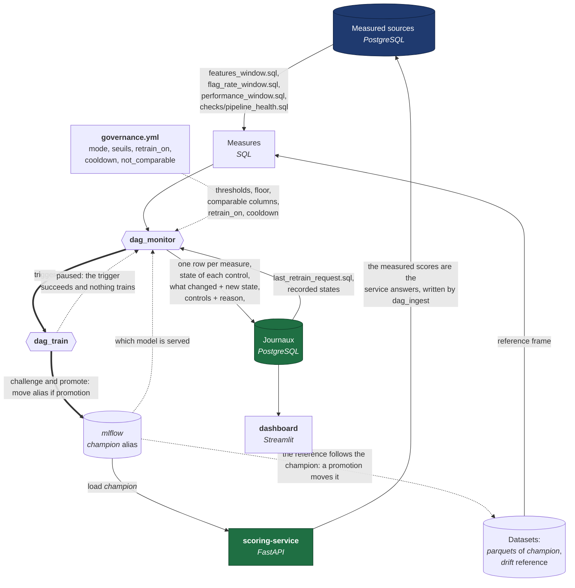
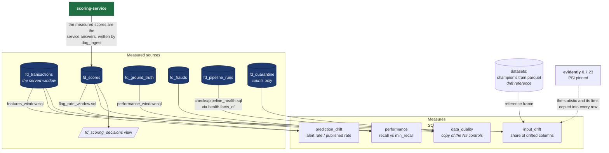
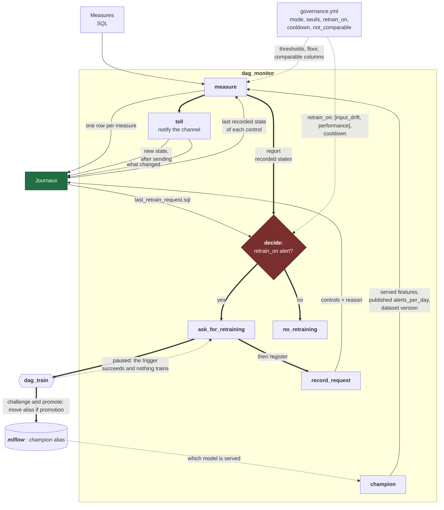
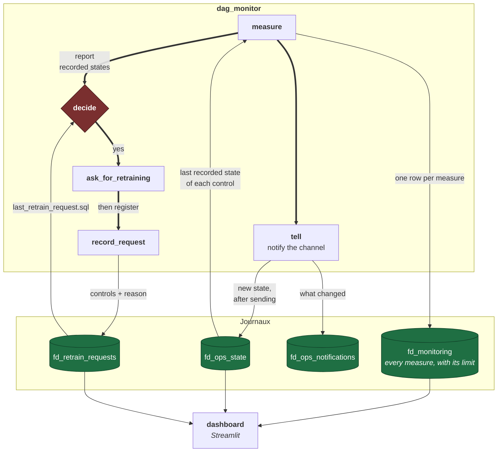
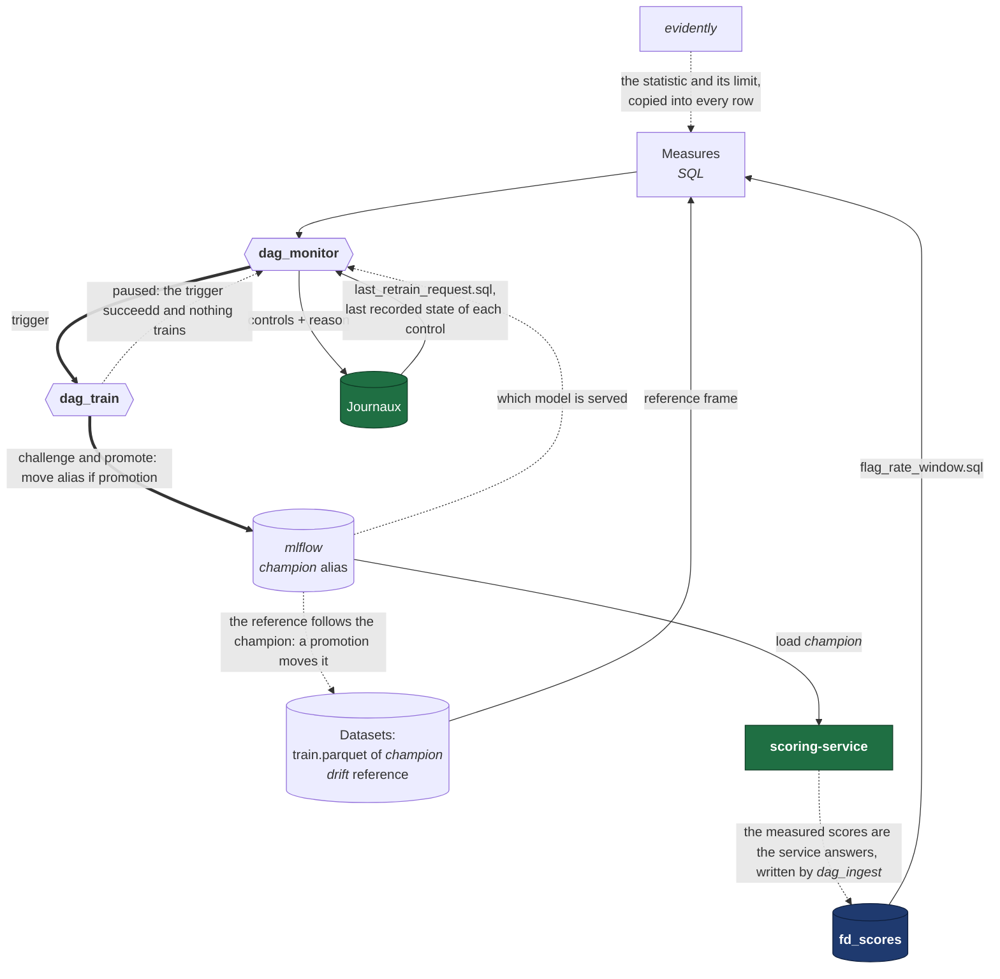

*MACHINE LEARNING FOR FRAUD DETECTION* PROJECT
===

# D1.A Monitoring Architecture

> *Nicolas Pichon --- AIA RNCP 38777 / BC04 / D1 : Monitoring Architecture / v01 --- 2026/11/26.*
---

> Sources : `airflow/dags/dag_monitor.py`, `ml4fd/monitor.py`, `sql/monitoring/*.sql`,
> et section `monitoring` de `governance.yml`. 

*Notations* :

| Notation | Nature | Ce qu'une rupture donne |
|---|---|---|
| `──▶` trait plein | **flux de données** | une mesure absente, un contrôle non mesurable |
| `══▶` trait gras | **flux de contrôle** | la boucle mesure, alerte, et ne réentraîne rien |
| `╌╌▶` pointillé | **dépendance** | une mesure incomparable, ou un seuil qui juge le passé |

## Le diagramme
  

###### overview

###### details 1 : measures

###### details 2 : monitoring & retraining

###### details 3 : journaux

###### details 4 : models registry closed loop 

## Ce que le diagramme dit

### `tell` et `decide` sont frères, pas en file

Les deux descendent de `measure` et ne se commandent pas l'un l'autre : `tell` peut déjà avoir commité la transition d'état, `decide` échoue sur la tâche suivante, et tous les passages ultérieurs ont mesuré la même alerte, n'ont trouvé aucune transition, et n'ont rien demandé. Une panne, et la demande était perdue pour de bon.

La règle de `decide` ne lit donc plus une transition mais une **alerte non répondue** : `fd_retrain_requests` est interrogée (`last_retrain_request.sql`), et c'est la flèche de `req` vers `decide` sur le diagramme. Elle rend la décision idempotente.

### Déclencher, puis consigner

`ask ══▶ rec` et non l'inverse. L'enregistrement suit le déclenchement, donc
une panne entre les deux **sous-estime** ce qui s'est passé au lieu
d'affirmer quelque chose qui n'a pas eu lieu. Une demande consignée pour un
réentraînement jamais déclenché serait un mensonge ; un réentraînement
déclenché non consigné est un trou, ce qui est la direction sûre.

### La référence suit le champion

`mlflow ╌╌▶ ref` porte la conséquence : la référence de dérive est le
`train.parquet` **de la recette du modèle en service**, trouvée par son
manifeste. Une promotion la déplace. C'est voulu — mesurer la dérive contre le
corpus d'un modèle que personne ne fait tourner ne dit rien — mais cela
signifie qu'un écart au repos n'est pas une constante : il change à chaque
promotion.

### Deux familles ne déclenchent rien

`retrain_on: [input_drift, performance]`. `prediction_drift` et `data_quality` sont mesurées, enregistrées, notifiées - et ne déclenchent pas. Une dérive du taux d'alerte appelle un seuil à rechoisir, pas un modèle à réajuster ; une alerte de qualité appelle le flux à réparer, et réentraîner sur un flux cassé apprendrait la casse.

C'est la raison pour laquelle l'injection de dérive du 20/11 se voyait parfaitement dans `prediction_drift` - 864 alertes/jour contre une limite de 151,8 - sans rien déclencher.

### La flèche rouge du diagramme

`train ╌╌▶ ask` est dessinée à l'envers du flux exprès. Un `dag_train` **en
pause** fait **réussir** le `TriggerDagRunOperator` : le run reste en file,
`record_request` consigne la demande, et rien n'entraîne. Trois fois ce piège
s'est refermé dans la même journée, à trois maillons différents.
`fd-manager.ps1 monitor -Apply` active `dag_train` pour cette raison.

### Ce qui est surveillé est ce que le service a répondu

Avec le découplage, le pipeline `dag_ingest` appelle `/score/batch` et écrit les réponses du
service. `prediction_drift` et `performance` mesurent donc le **service**, et non plus un second modèle chargé dans le scheduler.

Deux conséquences d'exploitation à retenir :

- Une panne du service ne produit pas une mesure fausse, elle produit une   fenêtre sans mesure. `score_batch` est rouge, aucune ligne n'entre dans   `fd_scores`, et `prediction_drift` se mesure sur ce qui a été scoré avant.  Le contrôle ne passe pas en alerte : il n'a rien à juger. C'est
  `data_quality`, qui lit `fd_pipeline_runs`, qui voit la panne ;
- La latence du service est maintenant dans le chemin critique du pipeline. Un service lent allonge `score_batch` sans rien faire sortir d'une limite. Aucun des quatre contrôles ne regarde un temps de réponse - c'est précisément le rôle de l'exigence *B4-EC43*.

### Les appels tiers ne sont pas surveillés, et ce n'est pas un oubli

`fd_scoring_decisions` est sur le diagramme en gris : la vue existe et la
surveillance ne la lit pas. Elle lit `fd_scores` seule.

La raison n'est pas la paresse, c'est l'absence de population. Les deux
contrôles qui pourraient s'y intéresser ont tous deux besoin de quelque chose
qu'un appel tiers n'a pas :

- `performance` compare aux verdicts de `fd_ground_truth`. Un paiement soumis
  par un tiers n'est pas une transaction du pipeline : personne ne dira jamais
  s'il était frauduleux. Mesurer un rappel dessus serait mesurer sur zéro
  positif connu ;
- `prediction_drift` compare un taux d'alerte au taux publié, qui est une
  grandeur **par jour sur le flux servi**. Les appels tiers n'ont ni cadence ni
  volume déclarés — un tiers qui appelle dix fois en une minute ferait sortir le
  taux de ses bornes sans qu'aucune dérive se soit produite.

Surveiller le service pour lui-même demande d'autres grandeurs que celles de la boucle modèle : disponibilité, latence, part de 422. C'est B4-EC43 et c'est un cinquième `control`, pas une extension des quatre familles — ce qui impose une migration du `CHECK` de `fd_monitoring`.

### La limite évolue avec la mesure

Chaque ligne de `fd_monitoring` porte la limite qui était en vigueur au moment de la mesure, et non celle d'aujourd'hui. `max_drifted_share` est passé de 0,40 à 0,70 le 20/11 : relire le seuil en gouvernance à l'affichage redessinerait le passé contre la règle actuelle, et une série dont la limite bouge en silence n'est pas lisible. 
C'est aussi ce qui donne un sens à B4-EC45 : constater une évolution implique que l'unité de base ne change pas silencieusement.
