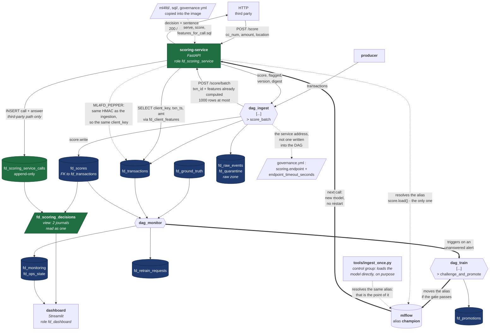
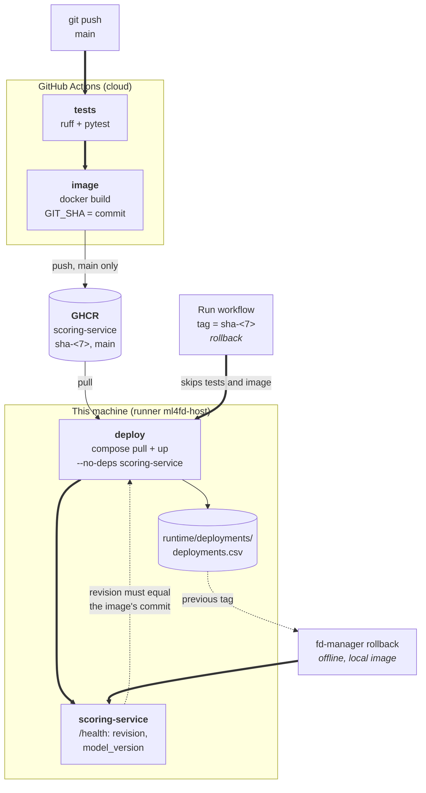

# D1.B. Scoring Service Architecture

> *Nicolas Pichon --- AIA RNCP 38777 / BC04 / D1 : Scoring Service Architecture  / v01 --- 2026/11/26.*
---

> Source : `docker-compose.yml`, `sql/ddl/`, `airflow/dags/dag_ingest.py`, `scoring_service/app.py`, `scoring_service/Dockerfile`, `.dockerignore`, `.github/workflows/ci.yml`, `ml4fd/serve.py` et `ml4fd/score.py`.

*Légende :*

| Notation | Nature | Ce qu'une rupture donne |
|---|---|---|
| `──▶` trait plein | **flux de données** | une table vide, un appel sans réponse |
| `══▶` trait gras | **flux de contrôle** | la boucle tourne et ne décide rien |
| `╌╌▶` pointillé | **dépendance** | le composant ne démarre pas, ou sert le mauvais modèle |

## Le diagramme

## Ce que le diagramme dit 

### Une seule flèche vers le registre

Le service est le seul processus qui charge le modèle. 

### La panne est échangée

La tâche `dag_ingest : score_batch`  était déjà rouge quand le registre était injoignable ; il est maintenant rouge quand le service l'est. Une dépendance externe remplace une autre, et le remède est nommé dans le message plutôt que laissé dans une trace d'exécution. L

es transactions sont déjà stockées quand l'appel échoue : rien n'est perdu, et l'opérateur voit quelle étape s'est arrêtée au lieu de lire un avertissement dans un run vert.

### Le témoin est dans le diagramme exprès

`tools/ingest_once.py ╌╌▶ mlflow` est la seule flèche qui subsiste vers le registre depuis le chemin par lot, et elle est volontaire. L'outil charge le modèle en direct et le journalise à l'exécution. Il sert de *témoin* : si les deux chemins divergent un jour, c'est lui qui le montre.

### Les deux chemins n'envoient pas les mêmes features

Asymétrie à lire sur les flèches : le chemin tiers fait lire `fd_transactions` au service, le chemin par lot ne le fait pas.

- Un *tiers envoie un paiement brut. Le service calcule les features lui-même, et c'est là qu'il a besoin de trois colonnes de `fd_transactions`  et du poivre (*pepper*).
- `dag_ingest` a déjà calculé les features à l'étape `type_and_feature`. Il les envoie dans la requête. `/score/batch` ne touche pas la base du tout.

Recalculer les features dans le service pour le chemin par lot produirait un second jeu de valeurs susceptible de contredire le premier - le principe que ce dépôt applique déjà deux fois ailleurs (`data_quality.from_existing_controls`, `score.py`).

## Ce que le service ne peut pas faire

`sql/ddl/145_scoring_service_role.sql` donne à `fd_scoring_service` trois colonnes de `fd_transactions` en lecture et aucun droit d'écriture. Il n'y a donc pas de flèche de `scoring-service` vers `fd_transactions` en écriture, et il ne peut pas en apparaître une par inadvertance : la base refuserait.

Pas de flèche vers `fd_raw_events`, `fd_quarantine`, `fd_ground_truth` ni `fd_datasets` : aucune autorisation. Un service qui verrait les verdicts pourrait se voir demander s'il a eu raison, et cette question appartient à la surveillance, sur une fenêtre, pas à un appelant sur un paiement.

## Deux journaux, une vue, et une convergence

`fd_scores` et `fd_scoring_service_calls` restent deux tables, et la raison est
une clé étrangère :

- `fd_scores` a pour clé primaire `txn_id` et porte  `REFERENCES fd_transactions (txn_id)`. Elle ne peut enregistrer un score que  pour une transaction déjà ingérée et validée. Cette garantie appartient à qui  détient la donnée, donc `dag_ingest` continue d'écrire cette table lui-même.
- un appel tiers est le cas inverse : un paiement dont on demande l'avis, que le pipeline n'a jamais vu et ne verra peut-être jamais. La clé étrangère refuserait tout appel honnête.

Une décision est donc enregistrée une fois, par celui qui détient ce qui la rend re-dérivable. `/score/batch` n'écrit rien : écrire là donnerait deux lignes pour une décision.

`sql/ddl/195_scoring_decisions.sql` crée la vue `fd_scoring_decisions`, qui lit les deux journaux comme un seul avec une colonne `source` (`pipeline` ou `tiers`). C'est elle, et non les tables, que les lecteurs doivent interroger : le jour où le service devient le seul à journaliser, la vue change et les lecteurs ne changent pas.

Cette convergence - une table unique écrite par le service seul - est nommée dans le fichier de la vue, avec son obstacle : `raise_from_scores.sql` joint `fd_scores` sans se protéger d'un `txn_id` nul, donc il lui faudra `AND txn_id IS NOT NULL` avant que le journal unique puisse porter des appels tiers. Elle n'est pas planifiée.

## La dépendance la plus silencieuse

Le lien `mlflow ══▶ scoring-service` est fragile.

`score.load()` résout l'alias avant de consulter son cache, et la clé du cache est `(nom, version)`. Une promotion donne donc une autre clé, un défaut de cache, et le nouveau modèle - sans que personne ait à redémarrer le service ni à se souvenir d'appeler quoi que ce soit.

C'est la panne la plus silencieuse du système : une boucle qui décide correctement et sert l'ancien modèle jusqu'au prochain redémarrage. Elle est évitée dans `ml4fd/score.py`, pas dans le service.

Avec le découplage du service cette flèche porte tout le chemin de production : une promotion atteint le pipeline par le service et par rien d'autre. C'est la troisième clause du critère de L5, et la seule des trois qui reste à constater plutôt qu'à déduire du code.

## Le pseudonyme partagé

`scoring-service ╌╌▶ fd_transactions` porte `ML4FD_PEPPER` plutôt qu'une donnée. C'est une dépendance de **valeur** : le service calcule `client_key` avec le même HMAC et le même poivre que `ml4fd/transform.py`. Sans cela, un appel et une transaction du même porteur cesseraient de se joindre - et rien ne le dirait. C'est aussi la seule raison pour laquelle ce conteneur reçoit le poivre, que le tableau de bord, lui, ne reçoit pas.

## L'adresse n'est pas dans le DAG

`dag_ingest ╌╌▶ governance.yml` existe pour la même raison que
`realtime.endpoint` : une adresse écrite dans un DAG est une adresse que
personne ne peut changer sans modifier un DAG. `scoring.endpoint` et
`scoring.endpoint_timeout_seconds` vivent en gouvernance, et un test refuse un
`http://` dans le corps de la tâche.

Conséquence d'exploitation : le scheduler lit la gouvernance **au démarrage du
processus**. Ajouter ces clés demande de recréer `airflow-scheduler`, pas
seulement de relancer le DAG.

## Le code est dans l'image, et l'image vient de la chaîne

`ml4fd/` et `sql/` sont copiés dans l'image du service à sa construction, avec `governance.yml`,
et le seul montage restant est `runtime/datasets`, en lecture. Ce qui entre dans l'image est fixé par une liste blanche, `.dockerignore` à la racine du dépôt : rien d'autre, et en particulier ni `.env` ni `runtime/`.

La copie ne duplique aucune décision : le DAG n'exécute pas le modèle, il appelle le service. Le code de décision n'a donc qu'un exemplaire en production, celui de l'image.

Trois propriétés vérifiées :

- **Sans intervention** (B4-EC27). Un *push* sur `main` enchaîne `tests`,
  `image` puis `deploy`. Une pull request construit l'image sans la publier
  et ne déclenche jamais de déploiement : aucun code non fusionné ne
  s'exécute sur cette machine.
- **Traçable** (B4-EC27). Le commit complet est écrit dans l'image à sa
  construction (étiquette OCI `revision`, variable `ML4FD_REVISION`) et
  annoncé par `/health`, à côté de la version du modèle. Le déploiement
  échoue si `/health` n'annonce pas le commit de l'image déployée. Chaque
  déploiement ajoute une ligne au journal : date, étiquette, commit, empreinte
  de l'image, version du modèle, lien vers le run.
- **Réversible** (B4-EC30). Le retour arrière relance le job `deploy` à la
  main avec une étiquette déjà publiée, sans rien reconstruire : l'image
  remise en service est celle qui avait été testée à l'époque. Le commit
  attendu est lu dans l'image, pas dans le run. `fd-manager rollback` fait la
  même chose sans GitHub, à partir d'une image déjà présente sur la machine.

**Les secrets** (B4-EC29). L'accès au registre passe par le `GITHUB_TOKEN`
fourni à chaque run. Les secrets de la pile restent dans `.env`, hors du dépôt
et hors de l'image, et un test refuse toute valeur en clair dans
`docker-compose.yml`.

**Conséquence d'exploitation.** `governance.yml` est maintenant dans l'image
du service. Une modification de la section `scoring` atteint donc le service
par un déploiement, pas par un simple redémarrage. Pour essayer une
modification locale avant de la pousser, `fd-manager scoring-service`
construit une image depuis le dossier de travail, étiquetée `local`, qui reste
en service jusqu'au déploiement suivant.
